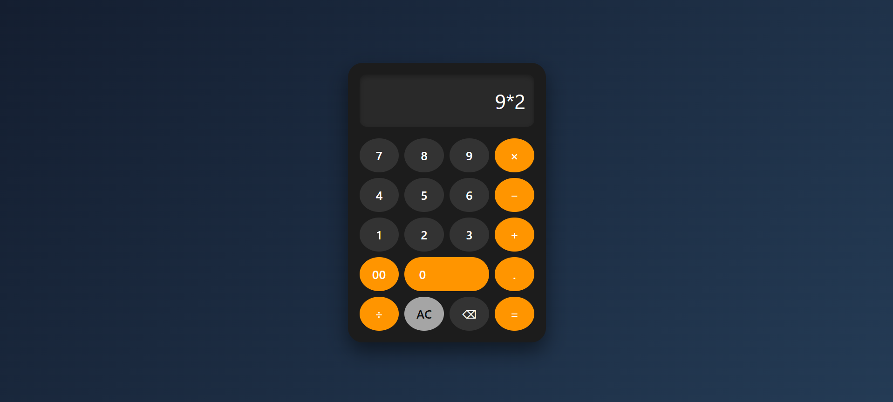

# 🧮 Web Calculator

A clean, responsive calculator built with HTML, CSS, JavaScript and Bootstrap. It has a modern dark theme with rounded buttons, and handles basic arithmetic right in the browser.

## 📸 Screenshot



## ✨ Features

- Addition, subtraction, multiplication and division
- Decimal point and double-zero (`00`) buttons
- **AC** to clear the screen and **⌫** to delete the last character
- Dark theme with orange operator buttons
- Hover and click animations on every button
- Responsive layout that works on desktop and mobile

## 🛠️ Built With

- **HTML5**: structure
- **CSS3**: custom styling, CSS Grid, responsive design
- **JavaScript (Vanilla)**: calculator logic
- **Bootstrap 5**: base styling for the display input

## 📁 Project Structure

```
calculator/
├── calculator.html   # Page markup
├── style.css         # Styling and responsive rules
├── script.js         # Calculator logic
└── screenshot.png    # Preview image used in this README
```

## 🚀 Getting Started

1. Clone the repository:
   ```bash
   git clone https://github.com/MuhammedRizwan2385/calculator-project.git
   ```
2. Open the project folder:
   ```bash
   cd calculator-project
   ```
3. Open `calculator.html` in your browser. No installation or build step needed.

## 🎮 How to Use

1. Click the number and operator buttons to build an expression.
2. Press **=** to see the result.
3. Press **⌫** to remove the last character, or **AC** to clear everything.

## 🔮 Future Improvements

- Keyboard support
- Replace `eval()` with a safe expression parser
- Calculation history
- Percentage and parentheses buttons
- Light/dark theme toggle

## 📄 License

This project is open source and available under the [MIT License](LICENSE).

## 👤 Author

**Rizwan**
Built as a practice project to strengthen front-end fundamentals.
